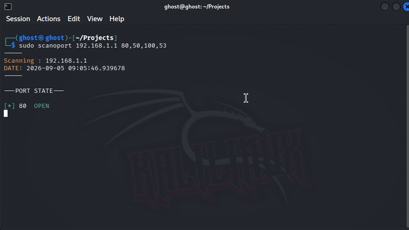

# ScanoPort 🛡️

A modular, dependency-free CLI TCP port scanner written in Python 3. Designed for lightweight network reconnaissance, baseline security assessments, and custom scanner integration.

---

## Key Capabilities ⚡

* **Modular Design**: Clean separation between argument parsing, target resolution, and network interaction.
* **Flexible Input Specifications**: Accepts individual ports, arbitrary comma-separated lists, range boundaries, or default top-port profiles.
* **Domain & IP Resolution**: Native IPv4/IPv6 address parsing and hostname resolution.
* **ARP Scan**: Discover live hosts (IP + MAC) on your local network with `-a <interface>`.
* **Zero External Dependencies**: Built entirely on standard Python 3 core modules (`socket`, `sys`, `ipaddress`).

---

## Demo 



---

## Installation & Deployment 📦
```
git clone https://github.com/alpha-bet-404/ScanoPort.git
cd ScanoPort/ScanoPort
chmod +x scanoport
```

# Optional: Create system-wide binary link
```
sudo ln -sf "$(pwd)/scanoport" /usr/bin/scanoport && sudo ln -sf "$(pwd)/scanoport" /usr/local/sbin/scanoport
```
---

## Usage Syntax & Examples 🎯

# Basic usage
```
scanoport <Target_IP_or_Domain> [Port_Specification]
```
# Single target port
```
scanoport 192.168.1.1 80
```
# Arbitrary port list
```
scanoport scanme.nmap.org 22,80,443,8080
```
# Sequential port range
```
scanoport 10.10.10.1 1-1024
```
# ARP scan the local network of an interface
```
sudo scanoport -a eth0
```
# ARP scan a specific network
```
sudo scanoport -a eth0 192.168.1.0/24
```
> ARP scan needs Linux + root, and works on IPv4 local networks only.

---

## Project Structure 🏗️

ScanoPort
```
  ├── scanoport           # Primary execution CLI interface
  ├── check.py            # Target resolution and input validation logic
  ├── TypesForScan.py     # Socket connection handling & scan loops
  ├── arp.py              # ARP scan (raw socket, local network discovery)
  └── ports.py            # Static port list mappings & top-ports data
```
---

## License 📜

Distributed under the MIT License.
